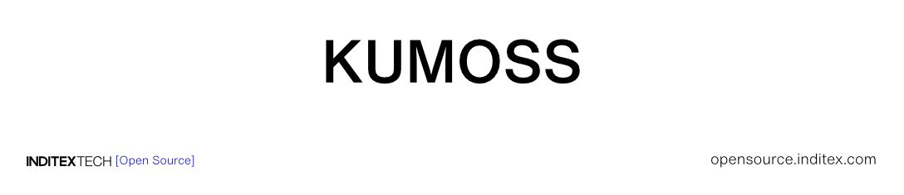

<!--
SPDX-FileCopyrightText: 2026 INDUSTRIA DE DISEÑO TEXTIL S.A. (INDITEX S.A.)

SPDX-License-Identifier: Apache-2.0
-->

### AI-powered Infrastructure as Code, governed by your rules

Turn natural-language requests into validated Opentofu/Terraform pull requests.
Kumoss generates infrastructure, corrects drift, enforces your policies and keeps
humans in control of high-impact or not compliant changes.

**[Quickstart](https://inditextech.github.io/kumoss/stable/main/quickstart/)** ·
**[Documentation](https://inditextech.github.io/kumoss/stable/)** ·
**[See it in action](https://inditextech.github.io/kumoss/stable/main/see-it-in-action/)** ·
**[Roadmap](https://inditextech.github.io/kumoss/stable/main/roadmap/)** ·
**[Issues](https://github.com/InditexTech/kumoss/issues)**

https://github.com/user-attachments/assets/ef45c118-5356-4699-bcd2-870a92f2e304

<strong>Table of contents</strong>

- [Why Kumoss](#why-kumoss)
- [Get started](#get-started)
- [Features](#features)
- [How it works](#how-it-works)
- [Architecture](#architecture)
- [Documentation](#documentation)
- [Roadmap](#roadmap)
- [Built with](#built-with)
- [Security](#security)
- [Contributing](#contributing)
- [License](#license)

## Why Kumoss

Kumoss turns **natural-language requests into reviewed, compliant Infrastructure as Code (IaC)**. Platform engineers and developers describe what they need; Kumoss's agents generate Terraform-compatible HCL in the right repository, following your architecture, security, and networking standards. Every change is **validated, planned, reported, and audited for compliance** before Kumoss opens a pull request and applies it on request.

The result is **developer autonomy for infrastructure operations**: developers create, change, and maintain their own infrastructure, **day-2 included** (updates, drift remediation, importing existing resources), without waiting on the platform team or needing IaC expertise. It stays **safe and compliant**: your guardrails apply to every request, and anything high impact or non-compliant waits for an administrator.

|                         | Without Kumoss                                     | With Kumoss                                                      |
| ----------------------- | -------------------------------------------------- | ---------------------------------------------------------------- |
| **Asking for infra**    | Tickets, back-and-forth, HCL expertise required    | One sentence and a project                                       |
| **Day-2 operations**    | Queued behind the platform team                    | Self-service updates, drift fixes, and imports, within guardrails |
| **Drift**               | Discovered late, fixed by hand                     | Detected and folded back into the code in the same pull request  |
| **Standards**           | Enforced in review, if someone remembers           | Applied during generation and audited before every pull request  |
| **Risky changes**       | Caught after the fact                              | Session locked until an administrator approves                   |
| **Visibility**          | Raw `plan` output                                  | A readable report with impact and cost estimate                  |

## Get started

- **Try it locally in minutes.** Run the full stack on one machine with Docker Compose by following the **[Quickstart](https://inditextech.github.io/kumoss/stable/main/quickstart/)**.
- **Run it in production.** Plan a deployment for your team with **[Deploy to production](https://inditextech.github.io/kumoss/stable/main/guides/deploy-to-production/)**.

## Features

### 🧭 What Kumoss does for you

- **Compliant infrastructure from plain language.** A developer-friendly assistant that needs only your request and the project.
- **A validated plan, every time.** Kumoss reads your IaC code and what is actually deployed, treats the deployment as the source of truth, and corrects existing and impacted drift, day-2 changes included. The result is a passing Terraform/OpenTofu plan that follows your architecture, security, and governance rules.
- **Human review where it matters.** High-impact or non-compliant requests lock the session until an administrator reviews them.
- **A report people can read.** Every session ends with a summary of the proposal, its impact, and a cost estimate.
- **Several modes of operation.** Generate, remediate drift, or import console-created resources, for part of a project or all of it.

### 🏢 Designed to integrate with your existing infrastructure ecosystem

- **Works with what you already have.** Use your existing IaC repositories, Terraform state, and Git provider (GitHub, Azure DevOps, or GitLab).
- **Authorization is an extension point requiring an implementation. **
- ** LLM Model and identity provider are configured externally. **
- **Multicloud.** AWS, Azure, Google Cloud, Oracle Cloud Infrastructure, Kubernetes, and VMware vSphere.
- **Your rules, your definition of critical.** You decide what is allowed, what is high risk, and which compliance checks apply. Critical can mean special projects, every production environment, changes above a cost threshold, or any rule you write.
- **Full traceability.** An admin panel shows users, sessions, and roles, all stored in a database.
- **Observability built in.** Every agent and every system prompt read at runtime is traced with OpenTelemetry and Arize Phoenix.

### 🔌 How to integrate it into your ecosystem

| Component           | Bundled            | Bring your own                                                                                                   |
| ------------------- | ------------------ | ---------------------------------------------------------------------------------------------------------------- |
| **Model**           | — | Any [LiteLLM](https://docs.litellm.ai/)-supported model, including self-hosted ones, with web search included; |
| **Identity**        | —                  | Any OIDC provider                                                                                                |
| **Authorization**   | —                  | Your rules for who may request infrastructure, and where (authorization contract)                                |
| **IaC executor**    | OpenTofu/Terraform | Your own runtime, version, and execution environment (IaC contract)                                              |
| **Notifications**   | Slack webhook      | Any channel: Slack, Microsoft Teams, email, Discord, WhatsApp, … (notifications contract)                        |

Authorization, IaC, and notifications are sidecar services behind [OpenAPI contracts](contracts/openapi/); replace a bundled one or implement your own. Everything is exposed through a FastAPI API, with MCP and A2A support on the [roadmap](#roadmap) so other agents can use Kumoss directly.

## How it works

1. **You ask.** Describe the infrastructure you need in plain language and pick the project.
2. **Kumoss checks who you are.** It authenticates you and confirms you may work on that project.
3. **Kumoss gathers context.** Your deployed cloud infrastructure, IaC repository, request, and your organization's architecture, security, and governance standards.
4. **Kumoss builds a plan that passes.** It generates the code and runs a Terraform/OpenTofu plan, fixing and retrying until it passes.
5. **Kumoss fixes drift along the way.** What runs in the cloud is the source of truth, not the repository, so drift is fixed by updating the code to match.
6. **You get a clear report.** Impact, main changes, and estimated cost.
7. **A compliance agent reviews the proposal.** It checks the change against your policies and flags it as high impact if it meets your criteria. Kumoss then opens a pull request.
8. **Risky changes wait for review.** Non-compliant or high-impact proposals block apply and notify your administrators to accept or reject them.
9. **You apply.** Once cleared, you approve and apply, and get a new report with the result.

The video below is a real use case, an unscripted cloud session condensed for viewing. For a step-by-step walkthrough, see **[Kumoss in action](https://inditextech.github.io/kumoss/stable/main/see-it-in-action/)**.

https://github.com/user-attachments/assets/2ed5dc7f-4b1a-4273-b9c1-96f63fcc1706

## Architecture

The **[architecture documentation](https://inditextech.github.io/kumoss/stable/main/architecture/)** covers the components, the core's layering, data and state, and the end-to-end flow from a request to an applied plan.

## Documentation

The full documentation is published at **[inditextech.github.io/kumoss](https://inditextech.github.io/kumoss/stable/)**.

| Start here                                                                                           | Go deeper                                                                                                   |
| ---------------------------------------------------------------------------------------------------- | ----------------------------------------------------------------------------------------------------------- |
| [Quickstart](https://inditextech.github.io/kumoss/stable/main/quickstart/)                           | [Configuration reference](https://inditextech.github.io/kumoss/stable/main/reference/configuration/)        |
| [Make a request](https://inditextech.github.io/kumoss/stable/main/guides/make-a-request/)            | [LLM providers and models](https://inditextech.github.io/kumoss/stable/main/reference/llm-providers/)       |
| [Merge and apply](https://inditextech.github.io/kumoss/stable/main/guides/merge-and-apply/)          | [Enable authentication](https://inditextech.github.io/kumoss/stable/main/guides/enable-authentication/)     |
| [Explore the architecture](https://inditextech.github.io/kumoss/stable/main/architecture/)                       | [Configure state backends](https://inditextech.github.io/kumoss/stable/main/guides/configure-state-backends/) |
| [FAQ](https://inditextech.github.io/kumoss/stable/main/faq/)                                         | [Deploy to production](https://inditextech.github.io/kumoss/stable/main/guides/deploy-to-production/)       |

## Roadmap

- **Continuous operations:** scheduled drift detection and import (in progress).
- **Deployment and adoption:** Helm chart and installation wizard (in progress).
- **Cloud and code lifecycle:** from cloud to code, from code to cloud, and infrastructure diagrams.
- **Operations at scale:** bulk and multiproject requests.
- **Quality and governance:** evaluation harness, model benchmarking, and policy as code with Open Policy Agent.
- **Cost management (FinOps):** accurate cost estimates, cost guardrails, and FinOps integrations.
- **Agent interoperability:** MCP and A2A support.

See the full [roadmap](https://inditextech.github.io/kumoss/stable/main/roadmap/) for details.

## Built with

[FastAPI](https://fastapi.tiangolo.com/) · [React](https://react.dev/) · [LiteLLM](https://docs.litellm.ai/) · [OpenTofu](https://opentofu.org/) · [Terraform](https://developer.hashicorp.com/terraform) · [Arize Phoenix](https://phoenix.arize.com/) · [OpenTelemetry](https://opentelemetry.io/) · [PostgreSQL](https://www.postgresql.org/) · [Redis](https://redis.io/) · [RustFS](https://rustfs.com/) · [SearXNG](https://docs.searxng.org/) · [nginx](https://nginx.org/)

## Security

Please do not report security vulnerabilities through public issues. Use the [Inditex disclosure program](https://vdp.inditex.com) as described in [SECURITY.md](SECURITY.md).

## Contributing

We welcome contributions! Please read [CONTRIBUTING.md](CONTRIBUTING.md) and follow the [Code of Conduct](CODE_OF_CONDUCT.md). Open an issue before starting substantial work, and use [Conventional Commits](https://www.conventionalcommits.org/) for your commit messages.

## License

This project is licensed under the [Apache-2.0 License](LICENSE).

© 2026 INDUSTRIA DE DISEÑO TEXTIL S.A. (INDITEX S.A.)

