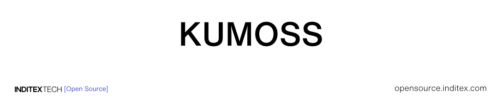

<!--
SPDX-FileCopyrightText: 2026 INDUSTRIA DE DISEÑO TEXTIL S.A. (INDITEX S.A.)

SPDX-License-Identifier: Apache-2.0
-->

<div align="center">



### One command from nothing to a running Kumoss stack

`kumoss` replaces the manual local setup — copying `env.sample` files, editing
`config.yaml`, keeping bearer tokens in step across three `.env` files and
rebuilding the core after every change — with a short wizard that writes them
all, consistently, into a managed directory.

**[Quickstart](https://inditextech.github.io/kumoss/stable/main/quickstart/)** ·
**[Documentation](https://inditextech.github.io/kumoss/stable/)** ·
**[Prerequisites](https://inditextech.github.io/kumoss/stable/main/prerequisites/)** ·
**[Issues](https://github.com/InditexTech/kumoss/issues)**

[](https://github.com/InditexTech/kumoss/releases)
[](../../LICENSE)
[](https://securityscorecards.dev/viewer/?uri=github.com/InditexTech/kumoss)
[](https://inditextech.github.io/kumoss/stable/)

</div>

<details>
<summary><strong>Table of contents</strong></summary>

- [Why the CLI](#why-the-cli)
- [Get started](#get-started)
- [Features](#features)
- [How it works](#how-it-works)
- [Who is the CLI for?](#who-is-the-cli-for)
- [Installing](#installing)
- [Commands and options](#commands-and-options)
- [The managed home](#the-managed-home)
- [Examples](#examples)
- [Uninstalling](#uninstalling)
- [Debugging](#debugging)
- [Documentation](#documentation)
- [Roadmap](#roadmap)
- [Built with](#built-with)
- [Security](#security)
- [Contributing](#contributing)
- [License](#license)

</details>

## Why the CLI

Kumoss's local deployment used to be a manual sequence: clone the repository,
copy two to five `env.sample` files, edit `config.yaml`, keep bearer tokens
identical across pairs of `.env` files, rebuild the core image after every
configuration change, and diagnose boot failures from a troubleshooting list.

`kumoss init` does all of that through an interactive terminal UI. It asks only
what the deployment needs, generates every secret, writes every file with
consistent values, mounts `config.yaml` so a change needs a container recreate
instead of an image rebuild, and offers to start the stack.

|                              | Manual setup                                    | With the CLI                                     |
| ---------------------------- | ----------------------------------------------- | ------------------------------------------------ |
| **`.env` files**             | Copy 2–5 samples, edit each one                 | Generated, `0600`, keys tracked from the samples |
| **Bearer tokens**            | Generate and paste into two files, keep in step | Random, written identically on both sides        |
| **`config.yaml`**            | Edit in the checkout                            | Overlaid from answers, upstream keys preserved   |
| **Changing configuration**   | Rebuild the core image                          | Recreate the core container                      |
| **Finding the files**        | Scattered in the checkout                       | One managed home, `~/.kumoss`                    |
| **Upgrading the CLI**        | —                                               | Re-run the installer                             |

## Get started

- **Try it locally in minutes.** Install the CLI and run `kumoss init`; see
  **[Installing](#installing)**.
- **Follow the full walkthrough.** The **[Quickstart](https://inditextech.github.io/kumoss/stable/main/quickstart/)**
  covers the same steps by hand and stays the reference path.

```bash
curl -fsSL https://raw.githubusercontent.com/InditexTech/kumoss/main/install.sh | bash
kumoss init
```

## Features

### 🧭 What the CLI does for you

- **Asks only what the deployment needs.** LLM provider and credentials, Git host, cloud credentials, IaC engine, state backend, optional Slack notifications.
- **Generates the shared secrets.** The core ↔ sidecar bearer tokens are random, written identically to both sides — nothing to paste twice or keep in step by hand.
- **Keeps the repository authoritative.** `config.yaml` is overlaid, not replaced: every key the wizard does not own keeps the value and behaviour the project ships.
- **Configuration without rebuilds.** The generated `config.yaml` is bind-mounted over the path the core already reads, so a change needs `docker compose up -d --force-recreate core`, never an image build.
- **Idempotent.** Every step is safe to repeat; a failed run is fixed by running it again, and an existing install is offered a reconfigure or a keep.

### 🏢 Designed to fit the stack you already run

- **Works with what you already have.** GitHub, Azure DevOps or GitLab; OpenTofu or Terraform; the bundled RustFS, an external S3-compatible store, an Azure Storage Account, or repository-declared state.
- **Multicloud.** AWS, Azure, Google Cloud, Oracle Cloud Infrastructure and Kubernetes, with only the methods that work inside the Compose stack.
- **Your rules, your definition of critical.** OIDC, the bootstrap administrator, the mapping and authorization sidecars and `llm.model_list` routing stay hand-edited in `config.yaml`; the CLI preserves the keys it does not own.
- **Nothing hidden.** Every generated file is plain text under `~/.kumoss`, readable, diffable and reviewable before the stack starts.

### 🔌 What the CLI covers

| Component           | Configured by the wizard | Hand-edited in `config.yaml`                     |
| ------------------- | ------------------------ | ------------------------------------------------ |
| **Model**           | Provider, models, credentials, tuning | `llm.model_list` routing             |
| **Git**             | Provider, author, token  | —                                                |
| **Cloud**           | Credentials for the IaC sidecar | Anything the wizard does not ask for     |
| **IaC executor**    | OpenTofu or Terraform    | The sidecar-supplied backend                     |
| **State**           | Four storage models      | Timeouts and presign settings                    |
| **Notifications**   | Slack webhook, on or off | —                                                |
| **Identity**        | —                        | OIDC and the bootstrap administrator             |
| **Authorization**   | —                        | The mapping and authorization contracts          |

Production deployment (Kubernetes, Azure Container Apps, secret stores, TLS
termination) is out of scope: see
**[Deploy to production](https://inditextech.github.io/kumoss/stable/main/guides/deploy-to-production/)**.

## How it works

1. **You install.** One `curl … | bash` puts a checksum-verified binary in `~/.local/bin`.
2. **The CLI checks the machine.** It detects the OS and architecture, then resolves the release to install.
3. **You run `kumoss init`.** The wizard asks for the LLM, Git, cloud credentials, the IaC engine, the state backend and notifications.
4. **It fetches the stack.** `docker-compose.yml`, `config.yaml` and the `env.sample` files come from the release tag the binary was built at.
5. **It writes every file.** `kumoss.yaml`, `config/config.yaml`, three `.env` files and `compose.override.yml`, atomically, with `.env` files at `0600`.
6. **It starts the stack.** Pulls the missing images and runs `docker compose up -d`, or attached with `--foreground`.
7. **You change something later.** Re-run `kumoss init`, choose Reconfigure, and change only what you need; the containers are recreated with the new values.

## Who is the CLI for?

- **Developers trying Kumoss** get a running stack on one machine without reading the manual setup, keeping bearer tokens in step by hand, or debugging a `.env` mismatch.
- **Platform engineers** hand teammates a reproducible install: one home directory, one generated file set, no per-machine drift.
- **Anyone reconfiguring** changes the model, the storage backend or a credential without rebuilding an image or editing four files by hand.
- **Maintainers and teammates debugging** get one place for the logs, the resolved compose file and the generated `.env` files; see [Debugging](#debugging).

## Installing

### The installer

```bash
curl -fsSL https://raw.githubusercontent.com/InditexTech/kumoss/main/install.sh | bash
```

The script detects the OS and architecture (`uname`, WSL2 treated as Linux),
resolves the version from `KUMOSS_VERSION` or the latest release, downloads the
archive and `checksums.txt` with `curl` (falling back to `wget`), **verifies the
SHA-256 and aborts on a mismatch**, and installs to `KUMOSS_INSTALL_DIR`
(default `~/.local/bin`). It never uses `sudo` and never writes outside your
home. Re-running replaces the binary — an upgrade — and never touches an
existing stack.

| Variable              | Default                                              | Purpose                    |
| --------------------- | ---------------------------------------------------- | -------------------------- |
| `KUMOSS_VERSION`      | latest release                                       | Pin a version              |
| `KUMOSS_INSTALL_DIR`  | `~/.local/bin`                                       | Where the binary goes      |
| `KUMOSS_RELEASE_BASE` | `https://github.com/InditexTech/kumoss/releases`     | Release host, for a mirror |

### Upgrading in place

An existing binary can fetch and run the same installer, so there is no curl
line to paste again:

```bash
kumoss self-install
```

Either path needs `curl` or `wget` on your `PATH` — the script downloads the
release itself. With neither installed, both stop and ask you to install one.

### From source

```bash
git clone https://github.com/InditexTech/kumoss
cd kumoss/client/cli
go build -o ~/.local/bin/kumoss .
```

A build from source reports `kumoss dev (stack main)` and fetches the stack files
from `main`; set `KUMOSS_TAG=v1.2.3` to pin another tag.

### Requirements

|                     |                                                              |
| ------------------- | ------------------------------------------------------------ |
| **Docker**          | Engine or Docker Desktop, daemon running                     |
| **Docker Compose**  | v2, invoked as `docker compose`                              |
| **curl or wget**    | Either one; the installer downloads the release with it      |
| **OS**              | Linux (x86-64 or arm64), macOS (Intel or Apple silicon), WSL2 |
| **Resources**       | ~8 GB RAM and ~10 GB disk are comfortable                    |
| **Ports**           | **80** (the app) and **9000** (artifact downloads) must be free |

Native Windows is not supported; use WSL2 with Docker Desktop's WSL
integration.

## Commands and options

`kumoss --help` lists the commands; `kumoss help --all` lists every flag of every
command, grouped.

### `kumoss init`

Install or reconfigure the stack. See [How it works](#how-it-works).

| Flag             | Default      | Effect                                                                 |
| ---------------- | ------------ | ---------------------------------------------------------------------- |
| `--home <dir>`   | `~/.kumoss`  | Managed home; persisted for later runs                                 |
| `--dry-run`      | off          | Ask everything, write nothing; print the files a real run would write  |
| `--foreground`   | off          | Stream logs instead of detaching; Ctrl-C also stops the stack          |
| `--host-certs`   | off          | Trust this host's CA roots in `core` and `searxng`, behind a TLS proxy |

### `kumoss home`

| Flag             | Effect                                              |
| ---------------- | --------------------------------------------------- |
| `--home <dir>`   | Resolve, print and persist this root                |
| `--reset`        | Forget the persisted root and restore the default   |

### `kumoss uninstall`

Stops the stack and deletes the managed home. See [Uninstalling](#uninstalling).

| Flag             | Effect                                              |
| ---------------- | --------------------------------------------------- |
| `--home <dir>`   | Uninstall this root instead of the resolved one     |
| `--purge`        | Do not ask for confirmation                         |

### `kumoss version`

Prints `kumoss <cli-version> (stack <tag>)`. The version is also the tag the CLI
fetches the stack from, so a released binary always matches its stack.

### `kumoss self-install`

Downloads `install.sh` from the tip of `main` and runs it, so an old binary
still runs the current installer. Needs `curl` or `wget`, like the installer.

### `kumoss help`

| Flag       | Effect                                              |
| ---------- | --------------------------------------------------- |
| `--all`    | List every command's flags, grouped by command      |

### `kumoss status`, `logs`, `config`, `doctor`

Registered as placeholders for the day-2 commands and currently do nothing. Use
`docker compose` against `~/.kumoss/src` in the meantime; see
[Day-2 operations](#day-2-operations).

## The managed home

Everything lives under one directory, `~/.kumoss` by default.

```
~/.kumoss/
├── kumoss.yaml            # non-secret answers (0600)
├── src/
│   ├── docker-compose.yml # downloaded at the release tag
│   ├── core/.env          # generated (0600)
│   └── services/
│       ├── iac/.env       # generated (0600)
│       ├── notifications/.env
│       └── searxng/
├── config/
│   ├── config.yaml        # generated, mounted into the core
│   └── config.yaml.example# the repo's file, verbatim, comments included
└── compose.override.yml   # generated
```

Choose another root with `--home <dir>` (persisted), `KUMOSS_HOME=<dir>`, or by
leaving the default. `kumoss home` prints which one is in use.

### What each file is

| File                          | Written by | Safe to edit? |
| ----------------------------- | ---------- | ------------- |
| `kumoss.yaml`                 | the wizard | Yes — it is input for the next reconfigure |
| `config/config.yaml`          | the wizard | Yes, but a reconfigure overwrites it |
| `src/*/.env`                  | the wizard | Yes, but a reconfigure overwrites them |
| `compose.override.yml`        | the wizard | Only if you decline to regenerate it |
| `config/config.yaml.example`  | the CLI   | No — a verbatim copy for reference |

Every generated file is written atomically (temp file + rename), so a crash
cannot truncate an `.env` — the only copy of the stack's tokens.

## Examples

**Preview without writing.**

```bash
kumoss init --dry-run
```

Prints each would-be file with its path. The dry run generates the real tokens,
so do not paste its output into a ticket or a CI log.

**Install into a non-default home.**

```bash
kumoss init --home ~/kumoss-lab
kumoss home                       # Kumoss home is set to: /home/me/kumoss-lab
kumoss home --reset               # back to ~/.kumoss
```

**Behind a TLS-inspecting proxy.**

```bash
kumoss init --host-certs
```

**Watch the stack start.**

```bash
kumoss init --foreground
```

**Reconfigure one thing.** Run `kumoss init`, choose Reconfigure, change only
what you need. Leave all secrets unselected to keep a running stack's tokens
valid.

**Pin a version.**

```bash
KUMOSS_VERSION=1.2.3 curl -fsSL .../install.sh | bash
kumoss version                    # kumoss 1.2.3 (stack v1.2.3)
```

## Uninstalling

```bash
kumoss uninstall            # asks first
kumoss uninstall --purge    # no question, for a script
```

It runs `docker compose down -v` against the managed home, which stops the
containers and **deletes the four data volumes** (`kumoss_core_db_data`,
`kumoss_phoenix_db_data`, `kumoss_object_storage_data`, `kumoss_workspaces`),
then removes the home directory and the persisted `--home` pointer. The next
`kumoss init` therefore starts from an empty database, not from the old one.

A home with no `src/docker-compose.yml` skips the compose step and is simply
deleted. Answering anything but `y` leaves everything in place.

Two things survive on purpose:

- **The binary.** `rm ~/.local/bin/kumoss` (or `$KUMOSS_INSTALL_DIR/kumoss`).
- **The images.** `docker image prune -a` reclaims them, but it affects every
  project on the host.

Nothing is installed outside your home, so there is no system-wide cleanup.

## Debugging

The `status`, `logs`, `config` and `doctor` commands are placeholders. Until they
are implemented, use `docker compose` against the managed home:

```bash
cd ~/.kumoss/src
dc() { docker compose -f docker-compose.yml -f ../compose.override.yml "$@"; }

dc ps                             # service states and uptime
dc logs -f core                   # follow the core
dc config                         # the fully merged stack
```

### A failing run, in order

1. **Which binary ran?** `which kumoss && kumoss version` — a source build reports `dev`.
2. **Which home?** `kumoss home` — `KUMOSS_HOME` outranks a persisted `--home`, which surprises people.
3. **What would it write?** `kumoss init --dry-run` — no side effects.
4. **What did it write?** `ls -la ~/.kumoss/src/core` — `.env` files must be `0600`; an old timestamp means the file was skipped.
5. **What does compose think?** `dc config` — the only reliable answer to "is my mount there?".
6. **Why did a container stop?** `dc ps -a` then `dc logs --tail 50 core`.

### Common failures

| Symptom                                    | Cause and fix                                                       |
| ------------------------------------------ | ------------------------------------------------------------------- |
| `Cannot connect to the Docker daemon`      | Start Docker; on WSL2 enable the integration for the distribution   |
| Port 80 or 9000 in use                     | `ss -lntp` / `lsof -i :80`, stop the process, run `kumoss init` again |
| The core exits right after start           | `dc logs core`; the first error line names the cause                |
| Notifications container shows `Exited`     | Webhook missing or empty: re-run and paste one, or answer No        |
| A cloud credential file is not found       | File-based methods only; re-pick the cloud, or paste the GCP JSON inline |
| `bubbletea: could not open TTY`            | `kumoss init` needs a terminal; headless mode is not implemented    |

### Day-2 operations

After editing `config/config.yaml` or an `.env` by hand, recreate the affected
container — `restart` does not reload `env_file` or a mounted file:

| Changed                                | Recreate                                |
| -------------------------------------- | --------------------------------------- |
| `config/config.yaml`, `core/.env`      | `dc up -d --force-recreate core`        |
| `services/iac/.env`                    | `dc up -d --force-recreate iac`         |
| `services/notifications/.env`          | `dc up -d --force-recreate notifications` |
| `compose.override.yml`                 | `dc up -d`                              |

Rebuilding images is only needed when source code changed, never for
configuration.

### Developing the CLI

```bash
cd client/cli
go build ./... && go vet ./... && go test ./...
gofmt -l .                        # must print nothing
```

The suite needs no network, Docker daemon or TTY: every side effect goes through
an injected seam (`tui.UI`, `render.Download`, `docker.Runner`, `io.Writer`).
`--dry-run` swaps each writer for its pure `Render` counterpart. Commit subjects
must be [Conventional Commits](https://www.conventionalcommits.org/); every file
needs the SPDX header.

## Documentation

The full documentation is published at **[inditextech.github.io/kumoss](https://inditextech.github.io/kumoss/stable/)**.

| Start here                                                                                  | Go deeper                                                                                                     |
| ------------------------------------------------------------------------------------------- | ------------------------------------------------------------------------------------------------------------- |
| [Quickstart](https://inditextech.github.io/kumoss/stable/main/quickstart/)                  | [Configuration reference](https://inditextech.github.io/kumoss/stable/main/reference/configuration/)          |
| [Prerequisites](https://inditextech.github.io/kumoss/stable/main/prerequisites/)            | [LLM providers and models](https://inditextech.github.io/kumoss/stable/main/reference/llm-providers/)         |
| [Configure state backends](https://inditextech.github.io/kumoss/stable/main/guides/configure-state-backends/) | [Enable authentication](https://inditextech.github.io/kumoss/stable/main/guides/enable-authentication/) |
| [Environment variables](https://inditextech.github.io/kumoss/stable/main/reference/environment-variables/) | [Deploy to production](https://inditextech.github.io/kumoss/stable/main/guides/deploy-to-production/) |

## Roadmap

| Initiative                                        | Status      | Community opportunity                                      |
| ------------------------------------------------- | ----------- | ---------------------------------------------------------- |
| **Headless mode**                                 | Planned     | Describe the answers file your CI would want               |
| **Live credential validation**                    | Planned     | Run it against your providers and report what fails        |
| **Preflight checks**                              | Planned     | Share the host conditions that break a start               |
| **Day-2 commands: `status`, `logs`, `config`, `doctor`** | Planned | Propose the checks and fixes you need               |
| **Wizard polish: step sidebar, back navigation**  | Planned     | Describe where you got lost                                |
| **Published docs page for the CLI**               | Planned     | Contribute examples from your own setup                    |

The roadmap states intent, not commitment. See the full
[roadmap](https://inditextech.github.io/kumoss/stable/main/roadmap/) for details,
and [open an issue](https://github.com/InditexTech/kumoss/issues) to pick up an
opportunity.

## Built with

[Go](https://go.dev/) · [Cobra](https://github.com/spf13/cobra) · [Bubble Tea](https://github.com/charmbracelet/bubbletea) · [Huh](https://github.com/charmbracelet/huh) · [Lip Gloss](https://github.com/charmbracelet/lipgloss) · [GoReleaser](https://goreleaser.com/) · [Docker Compose](https://docs.docker.com/compose/)

## Security

Please do not report security vulnerabilities through public issues. Use the [Inditex disclosure program](https://vdp.inditex.com) as described in [SECURITY.md](../../SECURITY.md).

## Contributing

We welcome contributions! Please read [CONTRIBUTING.md](../../CONTRIBUTING.md) and follow the [Code of Conduct](../../CODE_OF_CONDUCT.md). Open an issue before starting substantial work, and use [Conventional Commits](https://www.conventionalcommits.org/) for your commit messages.

## License

This project is licensed under the [Apache-2.0 License](../../LICENSE).

<div align="center">

© 2026 INDUSTRIA DE DISEÑO TEXTIL S.A. (INDITEX S.A.)

</div>
